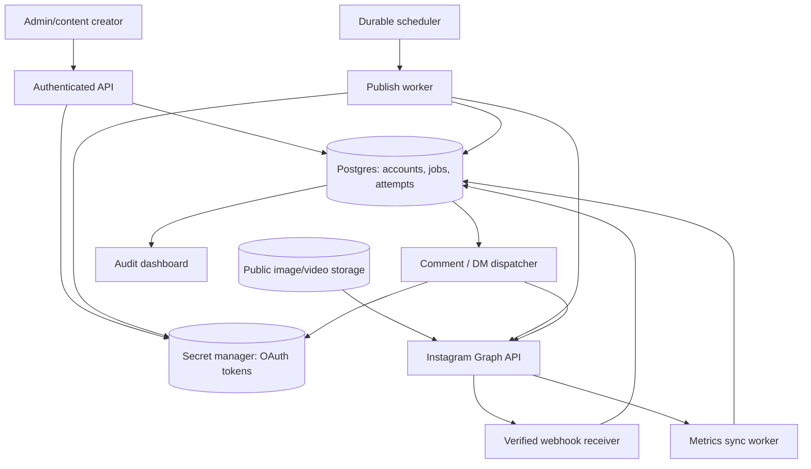

# Suggested architecture (NOT an implementation diagram of the original app)

## Trust boundaries

- Browser: signed-in human chooses target account, draft, publishing time, and consent. It never sees the Meta user token, Page token, app secret, or server-side Vault IDs.
- Authenticated API: verifies owner authorization and content permissions. Validates media dimensions, URLs, captions, and target account ownership.
- Database: owns account IDs, approved draft, job idempotency keys, scheduled timestamps (UTC), durable state, failure history, and audit trail.
- Vault: encrypted-at-rest account tokens. Use a narrow server-side `get_access_token(account)` capability. Only refresh workers update tokens; never put tokens in a SELECT returned to a browser.
- Worker: claims a job under a lease; rechecks account authorization, cancellation state, publish quota, URL availability, and token validity before Meta calls. This is the only component allowed to publish.
- Webhook receiver: verifies signature on exact raw body before parsing or inserting. App secrets unavailable means fail closed. Persist event and action intent, ACK, process asynchronously.
- Reconciliation worker: compares ambiguous `PUBLISHING` jobs against remote state. A timeout is NOT a reliable indication that publishing failed. Do not automatically issue a second `media_publish`.

## State contract

`DRAFT -> SCHEDULED -> CLAIMED -> CONTAINER_CREATED -> READY -> PUBLISHING -> PUBLISHED`.

Cancellation is allowed before irreversible publishing. `FAILED` is recoverable only through an explicit review/retry pathway. For a production queue consider separate `RETRY_WAIT` and `RECONCILIATION_REQUIRED` states. `PUBLISHING` is a safety boundary; on ambiguous failure, operator review or verified reconciliation is required.

## Idempotency rules

1. `(account_id, idempotency_key)` must be unique for publish jobs. Generate one idempotency key when an authenticated user approves a content item, not when a worker ticks.
2. Atomic DB claim and lease: `SELECT ... FOR UPDATE SKIP LOCKED`, using an ownership predicate or transaction to prevent two workers from publishing.
3. Store `creation_id` before any publish attempt, to avoid creating a fresh container on retry.
4. Store a `PUBLISHING` state before the network side effect. A crash afterward is ambiguous and needs reconciliation, not blind retry.
5. For comment automations, use a unique Instagram comment ID and `(event_id, action_type)` uniqueness. A redelivery can repair a missing action without duplicating another.
6. Receipt of a webhook is not equivalent to successful DM/reply send. Persist action status and the Graph response identifier.

## Deployment shape

The original buildpurdue implementation uses Next.js for admin APIs and Supabase Edge Functions for the live comment/story webhooks and insights sync. This reference kit uses platform-neutral Node ESM and does not bring its Prisma/Supabase/AWS/observability infrastructure with it. Deno and Node code may need separate entry points, imports, and cryptographic APIs.

## Video / carousel extensions

- For videos or Reels, create media container then **poll until `FINISHED`** before publish; `IN_PROGRESS`, `ERROR`, and `EXPIRED` must be handled. Media encoding restrictions matter.
- For carousels, create each child with `is_carousel_item=true`, then parent with child IDs. Validate current Meta requirements and limits.
- For Stories, eligibility and behavior vary by account type, login path, and API permissions. Verify from current official documentation before implementing.
- If your app needs collaborators or Instagram-native features that are unsupported in the API, a manual review/publish fallback remains necessary.
